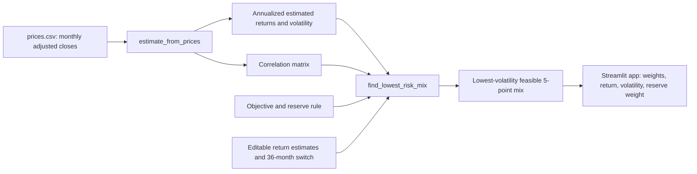

# Lab 15 — Portfolio Stability Decision

## Mandate and data

I used the Meridian Foundation Reserve mandate from Lab 13. The app's numeric
objective is a **6.5% estimated annual return**, a transparent proxy for CPI
plus 4% using a 2.5% CPI estimate. Its hard constraint is a **minimum 3.0%
reserve-eligible weight**. The optimizer is long-only by construction and tests
weights in 5-point increments.

My universe uses the four role-matched funds from Lab 14:

| Ticker | Fund | Role | Price source | Download date |
|---|---|---|---|---|
| BIL | SPDR Bloomberg 1–3 Month T-Bill ETF | Cash and reserve | Yahoo Finance Historical Data, monthly adjusted close | 2026-10-20 |
| IEF | iShares 7–10 Year Treasury Bond ETF | Government bonds / reserve eligible | Yahoo Finance Historical Data, monthly adjusted close | 2026-10-20 |
| LQD | iShares iBoxx $ Investment Grade Corporate Bond ETF | Investment-grade fixed income | Yahoo Finance Historical Data, monthly adjusted close | 2026-10-20 |
| VT | Vanguard Total World Stock ETF | Global equity | Yahoo Finance Historical Data, monthly adjusted close | 2026-10-20 |

`prices.csv` places the date first, keeps observations oldest first, and has one
column per ticker. All return figures displayed by the app are **historical
estimates, not forecasts**.

`app.py` also has an optional Alpha Vantage downloader. It requests five years
of monthly adjusted prices only after I enter my own API key in the running app;
the key is not stored in the code or repository. If I use that option, I will
download the generated `prices.csv` and update this table with Alpha Vantage as
the source and the actual download date.

## Engine flow



## Training verification

The app imports the calculations and Meridian inputs from `portfolio.py`; it
does not duplicate portfolio math.

| Scenario | Bills / 10-year / IG / equity | Return | Volatility |
|---|---:|---:|---:|
| Meridian as loaded | 0 / 20 / 25 / 55 | 6.51% | 9.44% |
| Equity estimate changed from 8.0% to 7.0% | 0 / 10 / 10 / 80 | 6.53% | 12.94% |

The largest weight change is **25 points**. A one-point decrease in the equity
estimate causes a large shift in the lowest-risk feasible allocation; this is
estimation risk, not evidence that either allocation is a forecast.

As an engine-link check, I temporarily changed the IG/equity correlation in both
cells of `portfolio.py` from 0.25 to 0.50 and refreshed the app. It changed to
0 / 40 / 0 / 60, with a 6.52% estimated return and 9.73% volatility. I then
restored the correlation to 0.25.

## My price-data results

I uploaded `prices.csv`, set the objective to 6.5%, retained the 3.0% reserve
rule, and ticked BIL and IEF as reserve eligible. The app reports the
all-months result beside the last-36-months result.

| Window | Lowest-risk feasible mix | Estimated return | Volatility | Reserve eligible |
|---|---|---:|---:|---:|
| All monthly returns | BIL 60% / IEF 0% / LQD 0% / VT 40% | 6.87% | 6.01% | 60.00% |
| Last 36 monthly returns | BIL 85% / IEF 0% / LQD 0% / VT 15% | 6.84% | 1.77% | 85.00% |

The largest weight change between these two windows is **25 points**. The
historical estimate is therefore sensitive to the window used; the app's output
is a starting allocation for discussion, not an automatically adopted decision.

## Partner attack

### Practice-only example (not a claimed partner interaction)

To rehearse the interaction, a mock partner distrusted the VT expected-return
estimate and changed it down one point, from 11.61% to 10.61%, using the
all-months data. The mix moved from BIL 60% / VT 40% to BIL 55% / VT 45%; its
estimated return was 6.81%, volatility was 6.74%, and the largest weight change
was 5 points.

**Model two-sentence response:** “A one-point lower VT return estimate changed
the selected allocation by 5 points and increased its estimated volatility from
6.01% to 6.74%. That sensitivity means I would pilot this allocation and revisit
it when the return estimates or the CIO's loss rule are clarified.”

### My live partner attack

Partner: _complete during lab_.

The estimate my partner changed: _complete during lab_.

My two-sentence response: _complete after the partner changes an estimate in my
app and reads the result aloud_.

## My call

I will choose **pilot, not adopt** as the starting recommendation if the
price-data stress test produces a material allocation change. I would adopt only
after the CIO defines the calendar-loss rule in S9 and resolves the missing
optimization criterion in S10; those conditions would make the decision rule
more complete than a return estimate and reserve minimum alone.

## Run command

```powershell
py -3.13 -m streamlit run app.py
```
